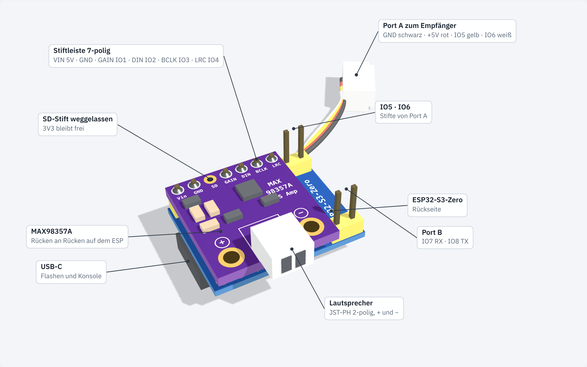
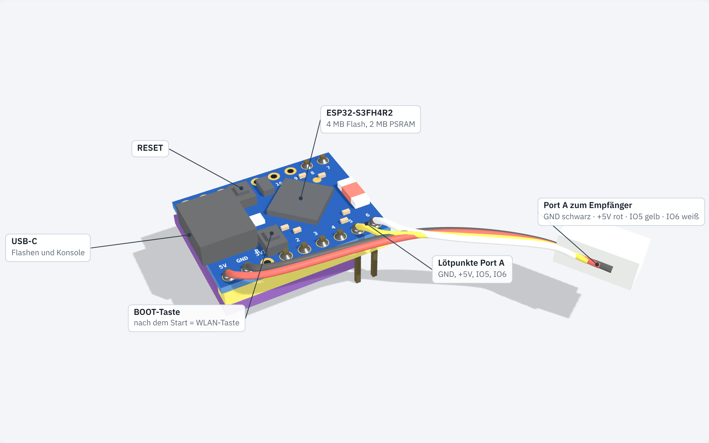
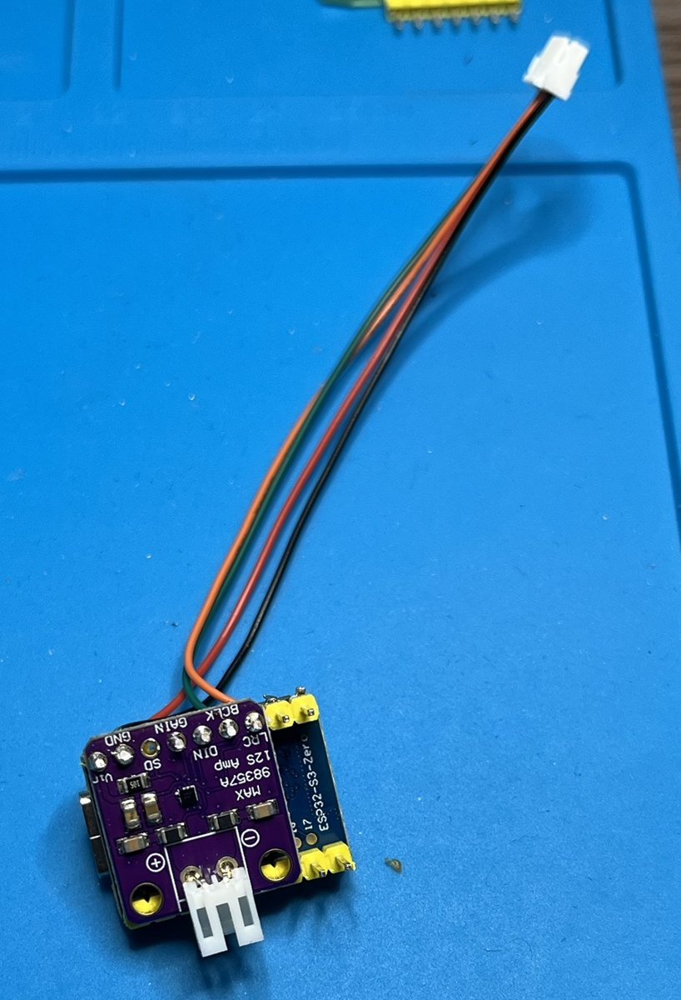
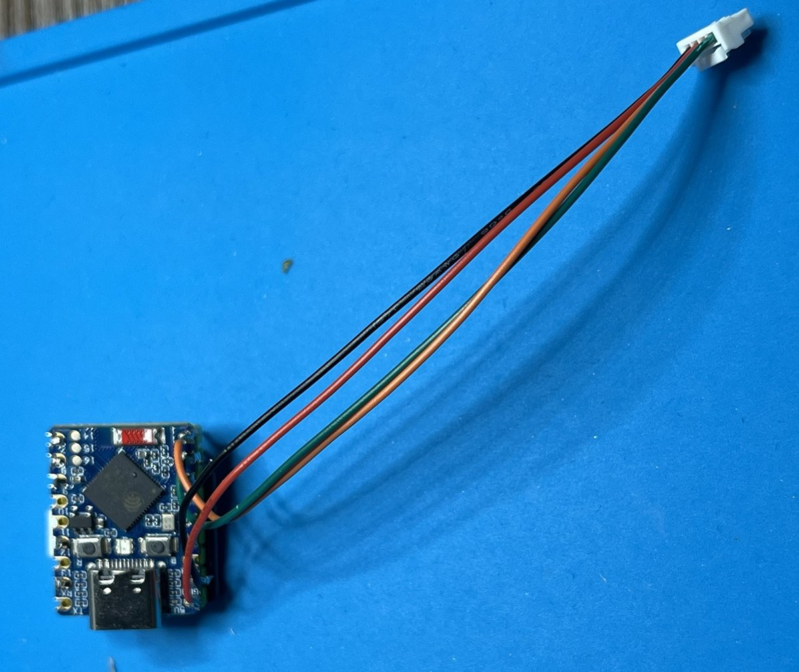
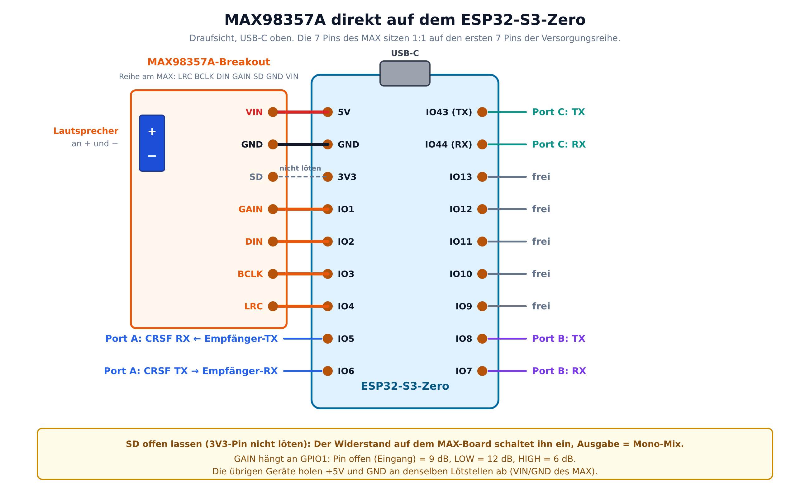

# Soundmodul Mini (S3)

Kompaktes Soundmodul für Motorgeräusche und Effekte auf Basis ESP32-S3-Zero (ESP32-S3FH4R2, 4 MB Flash, 2 MB PSRAM).
Abgeleitet von [ESP32-RC-Sound V7](https://github.com/mnorden81/mnorden81-ESP32-Sound-bidirectional_code), reduziert auf:

- **Eingang:** nur CRSF (Port A), busbasiert
- **Sounds:** Motor (Start/Loop/Stopp) + 4 Zusatzsounds
- **Speicher:** Flash (LittleFS), keine SD-Karte
- **Ports:** Port A (CRSF), Port B und Port C als Hardware-UART, Rolle je Port in Web-UI und Lua wählbar: Aus, CRSF (Modulkette), S.Port, GPS oder Raw
- **Status-LED:** RGB-LED des S3-Zero (GPIO 21) zeigt den CRSF-Link
- **Web-UI:** Sound-Upload und OTA-Update per WLAN, WLAN ab Werk immer an, sonst per BOOT-Taste oder Lua einschaltbar
- **Verstärker:** MAX98357A (I2S)

**Aktuelle Version:** v0.06 (nicht auf Hardware getestet)

Die Firmware ist eine Arduino-Skizze: `firmware/ESP32_Sound_Mini_S3/ESP32_Sound_Mini_S3.ino`. Gemeinsamer Code mit Multiswitch und Soundmodul V7 liegt in `firmware/ESP32_Sound_Mini_S3/src/RC_Common/` (identische Kopie, siehe README dort). Gebaut wird mit dem Arduino-ESP32-Core 3.0.7 (Arduino IDE oder PlatformIO).

Projektbeschreibung: [`docs/Projektbeschreibung.docx`](docs/Projektbeschreibung.docx) · Projektplan: [`docs/projektplan.md`](docs/projektplan.md)

## Flash-Aufteilung (4 MB)

2 × 1,25 MB Firmware (OTA) + ca. 1,3 MB Sounds (≈ 30 s bei 22,05 kHz, 16 Bit mono).

## Speicherbelegung anzeigen

Seit v0.06 zeigt das Modul, wie voll Flash und RAM sind:

- **Weboberfläche:** Tab „Debug“, Karte „Speicherbelegung“ (aktualisiert sich alle 2 s). Balken für Firmware, Sounds (Flash), RAM und PSRAM, ab 90 % gelb, ab 98 % rot.
- **Lua-Menü am Sender:** Ordner „Speicher“ (Felder 53–57, nur Anzeige): Firmware, Sounds, RAM frei, PSRAM frei. Die Werte werden beim Öffnen des Ordners neu gelesen.

| Anzeige | Bedeutung |
|---|---|
| Firmware | Größe der Firmware im Verhältnis zur App-Partition (1,25 MB). Die Firmware muss in eine Partition passen, sonst ist kein OTA-Update möglich. |
| Sounds | Belegter Platz im Flash-Dateisystem (Sounds und Einstellungs-Backups), ca. 1,3 MB |
| RAM | Freier interner Arbeitsspeicher, „min“ = kleinster Wert seit dem Start |
| PSRAM | Freier externer RAM (2 MB beim S3FH4R2) |

In der Arduino IDE steht nach „Überprüfen“ zusätzlich die Firmware-Größe im Ausgabefenster („Der Sketch verwendet … Bytes“).

## Sounds

Dateinamen: `start.wav`, `loop.wav`, `shut.wav`, `sound1.wav` … `sound4.wav` (16 Bit PCM, 22,05 kHz mono empfohlen).

Die Sounds liegen im Flash (LittleFS). Das Mini hat keine SD-Karte, die Auswahl Auto/Flash/SD gibt es seit v0.04 nicht mehr.

Sounds ins Flash bringen:

1. Web-UI: Tab „Motor“ bzw. „Sounds“ → WAV hochladen
2. USB: Dateien nach `firmware/data/` legen, dann `pio run -t uploadfs`

Konfigurations-Backups liegen ab v0.04 im Flash (Weboberfläche, Karte „Konfiguration sichern“: im Modul sichern, wiederherstellen, löschen; automatisch vor jedem Import und Firmware-Update). `pio run -t uploadfs` überschreibt den ganzen Flash-Speicher und damit auch diese Backups.

## Bauen

### Arduino IDE

1. Boardverwalter: „esp32“ von Espressif, Version **3.0.7**
2. Bibliothek: „TinyGPSPlus“ (Mikal Hart)
3. `firmware/ESP32_Sound_Mini_S3/ESP32_Sound_Mini_S3.ino` öffnen
4. Werkzeuge:
   - Board: **ESP32S3 Dev Module**
   - USB CDC On Boot: **Enabled**
   - USB Mode: **Hardware CDC and JTAG**
   - Flash Size: **4MB (32Mb)**
   - Partition Scheme: **Default 4MB with spiffs (1.2MB APP/1.5MB SPIFFS)**
   - PSRAM: **QSPI PSRAM**
5. Hochladen

Fertige Images baut die CI (GitHub Actions, Artefakt `sound-mini-s3-firmware`): `*.ino.bin` für das OTA-Update über die Weboberfläche, `*.merged.bin` als Komplett-Image ab Adresse 0x0 (z. B. mit https://espressif.github.io/esptool-js/).

### PlatformIO (alternativ)

```bash
cd firmware
pio run                 # Firmware bauen
pio run -t upload       # flashen
pio run -t uploadfs     # Sounds aus firmware/data/ ins Flash
```

## WLAN einschalten

Das Modul öffnet den Access Point „Sound-Mini“ (Passwort `123456789`), Weboberfläche http://192.168.1.1. Das WLAN geht an über:

1. **„WLAN dauerhaft an“** (ab Werk EIN): WLAN ist nach jedem Einschalten sofort an. Umschalten im Web-Tab „WiFi“ oder im Lua-Menü (Einstellungen → „WLAN dauerhaft an“), wirkt ab dem nächsten Start.
2. **BOOT-Taste:** Ist „WLAN dauerhaft an“ aus, blinkt die LED nach dem Einschalten 3 s lang blau. Wer in dieser Zeit kurz die BOOT-Taste des S3-Zero drückt, schaltet das WLAN ein. Die Taste beim Einschalten **nicht** gedrückt halten, sonst startet der ESP im Flash-Modus (dann einfach neu einschalten).
3. **Lua-Menü „WLAN jetzt“** (Einstellungen, Feld 46) oder der Schalter „WLAN jetzt“ in der Weboberfläche: sofort an oder aus, gilt nur bis zum nächsten Ausschalten.
4. **Auto-WLAN bei Signalverlust:** schaltet das WLAN ein, wenn länger als die eingestellte Zeit kein CRSF-Signal kommt.

Eine WLAN-Brücke oder ein Jumper ist seit v0.05 nicht mehr nötig, GPIO9 ist frei.

## Hardware

Bauplan mit Bauteilliste, Pinbelegung und Grafiken: [`docs/Hardware-Bauplan_Mini-S3.docx`](docs/Hardware-Bauplan_Mini-S3.docx).
Die Pins kommen aus `firmware/ESP32_Sound_Mini_S3/pins.h` (ein KiCad-Schaltplan fehlt noch). Eine SD-Karte gibt es nicht.

### Aufbau

Das Modul ist ein Sandwich aus zwei Platinen, ohne Lochrasterplatine (Aufbau von Martin, läuft):

- Der **MAX98357A** sitzt Rücken an Rücken auf der Rückseite des S3-Zero. Seine 7-polige Stiftleiste geht durch beide Platinen und trifft 5V, GND, 3V3, IO1 bis IO4 (VIN-5V, GND-GND, GAIN-IO1, DIN-IO2, BCLK-IO3, LRC-IO4). Den **SD-Stift weglassen**, 3V3 bleibt frei.
- Die Bauteilseite des ESP mit USB-C und BOOT-Taste bleibt frei zugänglich.
- **Port A** (Empfänger): 4 Kabel, auf der Bauteilseite an 5V, GND, IO5 und IO6 gelötet, mit 4-poligem JST-Stecker. Farben: schwarz GND, rot +5V, gelb IO5 (CRSF RX ← Empfänger-TX), weiß IO6 (CRSF TX → Empfänger-RX).
- **Port B**: 2 Stifte an IO7 (RX) und IO8 (TX), zeigen zur MAX-Seite.
- **Port C** (IO43/IO44) ist optional: bei Bedarf Kabel direkt an die Pins löten.
- **Lautsprecher** am 2-poligen JST-PH-Stecker des MAX (+ und −), nie an GND.

Größe ca. 23,5 × 19,5 × 9 mm ohne Kabel.





| MAX-Seite | ESP-Seite |
|---|---|
|  |  |

Auf den Fotos haben die Port-A-Kabel noch andere Farben (grün IO5, orange IO6).

### Pinbelegung




| Funktion | GPIO |
|---|---|
| MAX98357A direkt auf 5V, GND, 3V3, IO1..IO4 | GAIN 1, DIN 2, BCLK 3, LRC 4 |
| Port A CRSF RX / TX | 5 / 6 |
| Port B RX / TX | 7 / 8 |
| WLAN-Taste = BOOT-Taste auf dem S3-Zero | 0 |
| Port C RX / TX | 44 / 43 |
| Status-LED (WS2812 auf dem S3-Zero) | 21 |

## Versionen

| Version | Änderung |
|---|---|
| 0.06 | Speicherbelegung: Firmware, Sounds (Flash), RAM und PSRAM im Web-Tab „Debug“ (Karte „Speicherbelegung“) und im Lua-Ordner „Speicher“ (Felder 53–57, nur Anzeige). |
| 0.05 | WLAN-Taste statt WLAN-Brücke: Die BOOT-Taste (GPIO0) nach dem Einschalten innerhalb von 3 s kurz drücken schaltet das WLAN ein (nur wenn „WLAN dauerhaft an“ aus ist, LED blinkt dabei blau). GPIO9 und der Jumper entfallen. |
| 0.04 | Einstellungs-Backup im Flash statt auf SD-Karte (RC_Common 1.2.0), automatisch vor Import und Firmware-Update. Keine SD-Karte mehr, Sounds nur im Flash. |
| 0.03 | Gemeinsame Basis **RC_Common 1.1.0**: Core 3.0.7, CRSF-Bibliothek 1.1.0 mit Router (Port B/C mit Rolle CRSF reichen Frames zwischen Port A und dem Port weiter), Rollen mit gemeinsamen Nummern (Aus, CRSF, S.Port, GPS, Raw; alte Werte werden beim ersten Start umgerechnet), gemeinsame NVS-Schlüssel, Lua-Menü als Tabelle mit unveränderten Feld-IDs, Status-LED, WLAN-Failsafe und OTA aus RC_Common. Web-API: `portb_role`/`portc_role` statt `portb_mode`/`portc_mode` (alte Sicherungen werden umgerechnet). **GPS-Baudrate „Auto“** (Vorgabe für GPS, wie Betaflight): Der Port sucht die Baudrate des GPS selbst, stellt es auf 115200 Baud und 10 Hz um (ATGM336H und u-blox) und sucht neu, wenn 3 s keine Daten kommen. Baudraten in der Weboberfläche als Auswahlliste mit „Auto“. |
| 0.02 | Port C mit Rolle und Baudrate wie Port B, Pins verschoben |

## Ordner

- `firmware/` PlatformIO-Projekt
- `hardware/` Schaltplan, PCB
- `docs/` Projektbeschreibung, Projektplan, später Pinout und Changelog
- `backups/` funktionierende Stände (nur lokal, nicht im Repo)

## Lizenz

GPL-3.0, wie das Ursprungsprojekt (enthält Code von XTronical).
