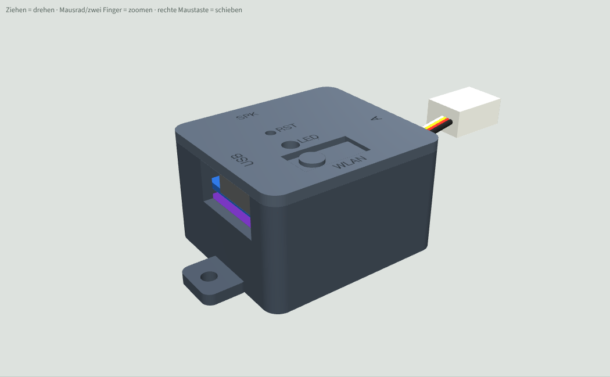
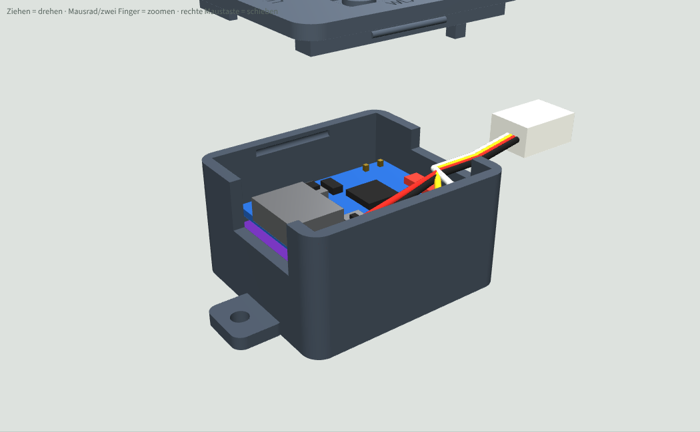

# Gehäuse für das ESP32 Sound Mini S3

3D-druckbares Gehäuse aus Unterteil und Deckel für den Sandwich-Aufbau (MAX98357A Rücken an Rücken unter dem ESP32-S3-Zero). Die ESP-Seite liegt oben, damit BOOT-Taste und LED am Deckel erreichbar sind. Die Maße stammen aus dem 3D-Modell [`docs/3d-modell/Aufbau3D_Mini-S3.html`](../../docs/3d-modell/Aufbau3D_Mini-S3.html).

| Zu | Offen |
|---|---|
|  |  |

## Dateien
| Datei | Inhalt |
|---|---|
| `Gehaeuse_Unterteil.stl` | Unterteil, druckfertig (Boden aufs Bett) |
| `Gehaeuse_Deckel.stl` | Deckel, druckfertig (schon gedreht, Oberseite aufs Bett) |
| `Gehaeuse_Unterteil.step`, `Gehaeuse_Deckel.step` | zum Weiterbearbeiten in Fusion 360 oder FreeCAD (Deckel in Einbaulage) |
| `gehaeuse.py` | Quelle (CadQuery), alle Maße als Parameter oben in der Datei |
| `Gehaeuse3D_Vorschau.html` | drehbare 3D-Vorschau mit Modul (im Browser öffnen, braucht Internet für three.js) |

## Maße
- Außen 30,0 × 26,8 × 18,2 mm (mit Deckel, ohne Laschen).
- Wand, Boden und Deckel je 1,6 mm.

## Öffnungen
- Stirnseite: USB-C (Kerbe oben offen, der Deckel schließt sie).
- Andere Stirnseite: Kabelschlitz für Port A (4 Adern zum Empfänger), optional Port C.
- Längsseite: Lautsprecher-Stecker JST-PH 2-polig, von außen einstecken.
- Boden: Fenster unter den Stiften Port B (IO7/IO8) und IO5/IO6, 2-poliger Dupont-Stecker von unten.
- Deckel: federnde Zunge mit Stößel über der BOOT-Taste (WLAN-Start), Fenster für die RGB-LED, Loch für RESET (Büroklammer), vertiefte Beschriftung.

## Annahmen (am echten Aufbau prüfen)
- Maße aus dem 3D-Modell, nicht nachgemessen: ESP 23,5 × 18 mm, MAX 18 × 19,4 mm, 2,5 mm Abstand (Kunststoff der Stiftleiste).
- BOOT und RESET 5 mm links und rechts der LED, 8,5 mm vom USB-Ende (aus dem Foto geschätzt).

## Drucken und Montieren
- PLA oder PETG, 0,2 mm Schicht (für die Schrift 0,12 mm), keine Stützen nötig.
- Modul mit der ESP-Seite nach oben einlegen, USB-C in die Kerbe, Port-A-Kabel in den Schlitz legen, Deckel aufdrücken.
- Das Modul liegt auf zwei Stützen im Boden und wird von zwei Niederhaltern am Deckel gehalten. Keine Schrauben, kein Kleber.
- Der Deckel klemmt mit einer Lippe und zwei Rastnasen. Sitzt er zu stramm, in `gehaeuse.py` `TOL` von 0,15 auf 0,2 erhöhen.
- Einbau ins Modell: 2 Laschen mit 2,4-mm-Loch (M2 oder Kabelbinder) oder doppelseitiges Klebeband.

## Ändern
Maße in `gehaeuse.py` anpassen und neu erzeugen (Python 3 mit `pip install cadquery`):
```
python gehaeuse.py .            # STL + STEP in diesen Ordner
python gehaeuse.py . --pruefen  # zusätzlich Kollisionsprüfung Modul gegen Gehäuse
```
